# Visual Walkthrough: Scanning a Drawer End-to-End

This walkthrough shows how **Homebox AI Inventory** turns a single smartphone photo of a cluttered drawer into a structured, searchable Homebox container with categorized items, quantities, and rich descriptions.

---

## 1. Choose Workflow & Target Container

Select **`New Box`** (or **`Re-Inventory`** / **`Add Items`**), pick an optional **Parent Location** (e.g., `Kitchen`), set the **Container Type** (`Box`, `Draw`, etc.), and give it a name.

  <table>
    <tr>
      <td align="center">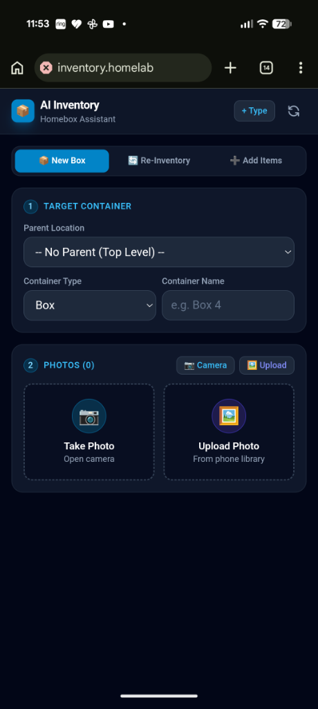 <b>1a.</b> Clean mobile-first PWA landing screen</td>
      <td align="center">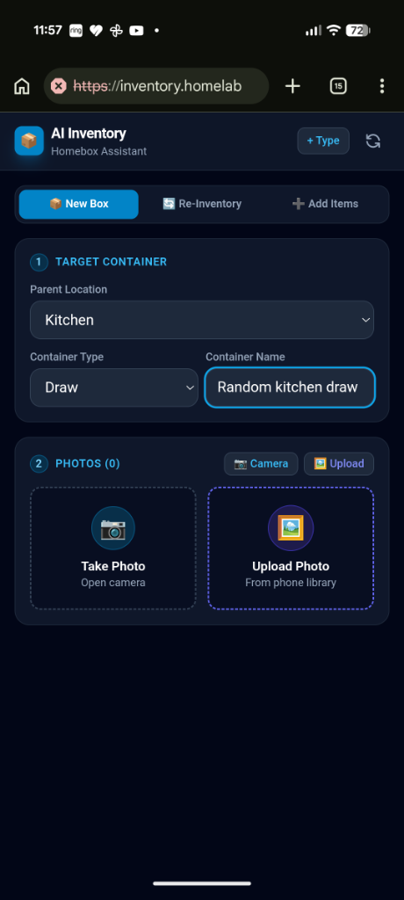 <b>1b.</b> Select parent location, type & container name</td>
    </tr>
  </table>

---

## 2. Capture Photos & Scan with AI Vision

Snap one or more angles directly with the camera or upload from your phone's photo library. High-res smartphone photos are resized in the browser (~250KB) before upload, and you can star (`⭐`) any angle as the primary Homebox cover photo.

  <table>
    <tr>
      <td align="center">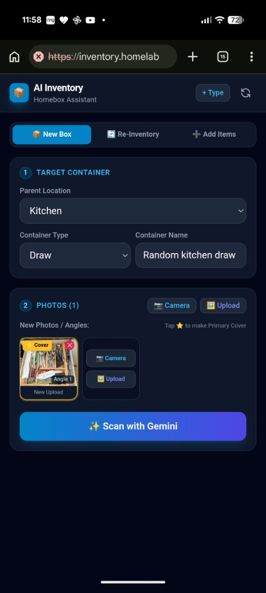 <b>2a.</b> Photo attached & marked as Cover; tap <b>Scan with Gemini</b></td>
      <td align="center">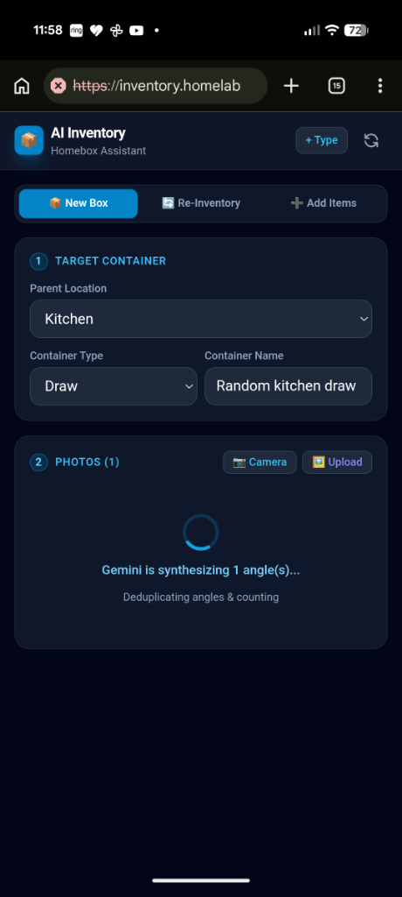 <b>2b.</b> AI vision analyzes, deduplicates & counts items</td>
    </tr>
  </table>

---

## 3. Review, Edit & Save to Homebox

Review every detected item before committing—adjust quantities with **`-` / `+`**, switch or create categories on the fly with **`+ Type`**, or tweak the AI-generated descriptions. When ready, tap **`Save to Homebox`**.

  <table>
    <tr>
      <td align="center">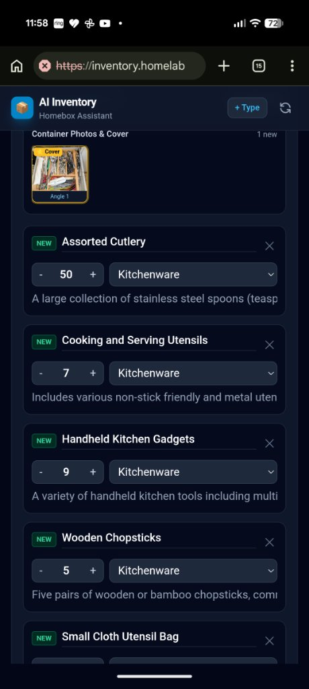 <b>3a.</b> Detected items, counts & categories</td>
      <td align="center">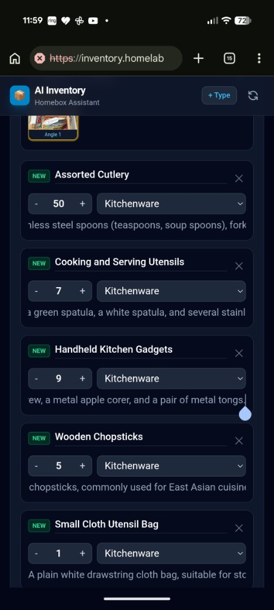 <b>3b.</b> Editable names, counts & descriptions</td>
      <td align="center">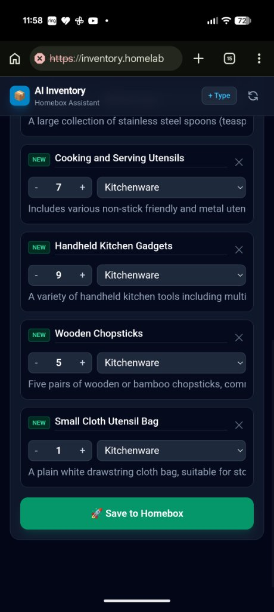 <b>3c.</b> One-tap commit to Homebox</td>
      <td align="center">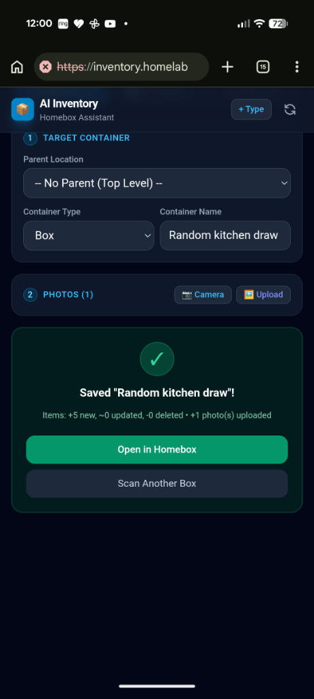 <b>3d.</b> Sync summary & direct <b>Open in Homebox</b> link</td>
    </tr>
  </table>

---

## 4. Instant Result in Homebox

Tapping **Open in Homebox** jumps straight to the newly created container under `Kitchen > Random kitchen draw`, complete with the cover photo and all 5 cataloged items ready to search.

  <table>
    <tr>
      <td align="center">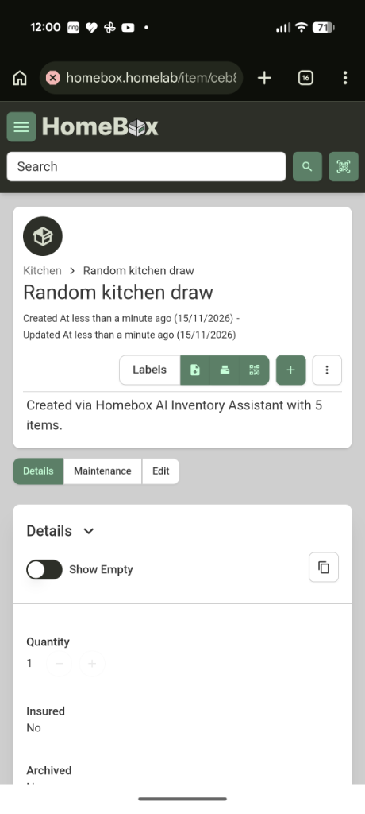 Random kitchen draw"> <b>4a.</b> Container created under parent location</td>
      <td align="center">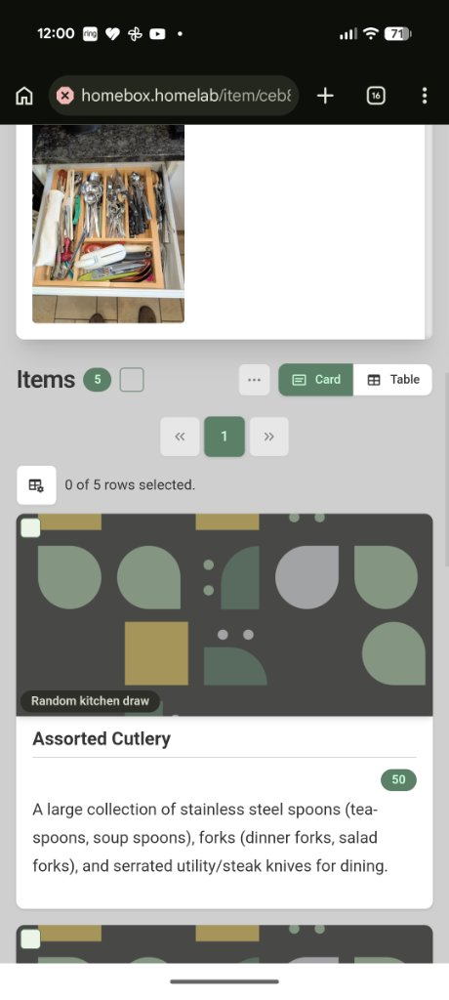 <b>4b.</b> Cover photo & indexed items</td>
      <td align="center">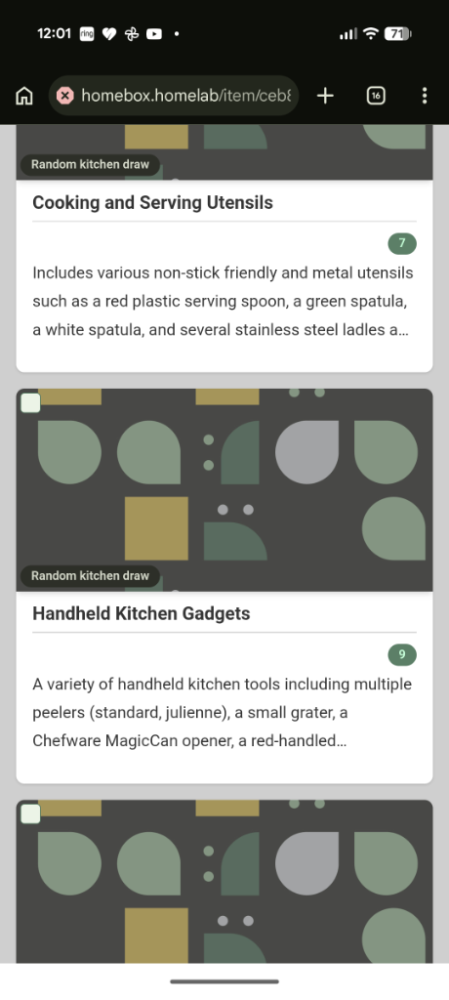 <b>4c.</b> Searchable quantities & detailed descriptions</td>
    </tr>
  </table>

